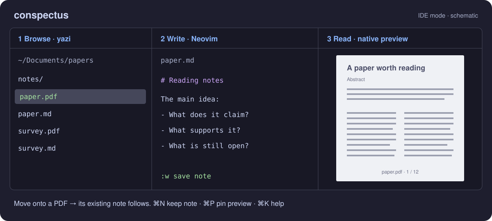

# conspectus

Browse files with yazi, preview them in a native macOS pane, and write notes beside the document you are reading. Your yazi configuration, keys and plugins come with you.



## Start here

Requires **macOS 13+, the Swift toolchain and [yazi](https://yazi-rs.github.io/)** on your login-shell PATH. IDE mode also needs **Neovim 0.7+** (`nvim`).

```sh
./build.sh
./bin/conspectus ~/Documents       # browse + preview
./bin/conspectus ide ~/Documents   # browse | edit | preview
```

Move the cursor in yazi to preview a file; use `j`/`k` to move, `l` to enter a folder and `h` to go up. Press **⌘K** for searchable shortcut help.

## Read a PDF and take notes

In IDE mode, move to `paper.pdf`: its existing `paper.md` opens in the editor while the PDF stays visible. Press **⌘N** to open or create the note explicitly, then save with `:w`. New notes are saved beside the PDF.

**⌘N keeps a note open** while you browse other PDFs (press again to unpin it). **⌘P holds the preview** on one file. **⌥← / ⌥→** move keyboard focus between panes; **⌘J** opens a terminal.

## Where to go next

- [IDE and PDF notes](docs/ide-notes.md): first session, note lookup, pins and editor setup.
- [Handbook](docs/handbook.md): installation, all modes, configuration, remote mounts and limitations.
- [Engineering notes](NOTES.md): why the implementation works this way. [TODO](TODO.md): open work. [CLAUDE.md](CLAUDE.md): contributor conventions.
- [MIT license](LICENSE)
