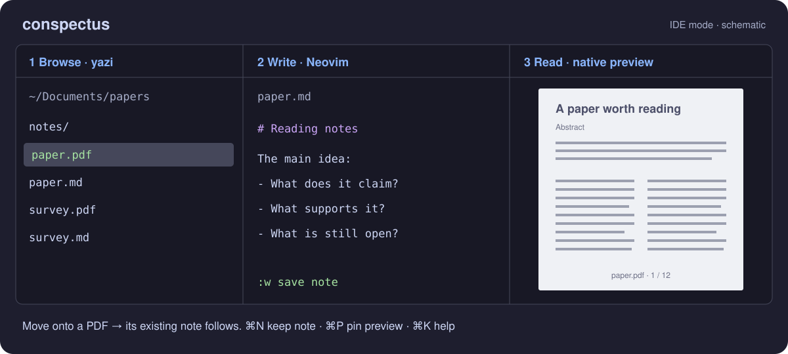

# IDE mode and PDF notes

[README](../README.md) · [Full handbook](handbook.md) · [Engineering notes](../NOTES.md)

IDE mode puts a file browser, a text editor and a document preview in one window. It is useful when you want to browse a folder of papers and write a Markdown note for each one, or edit a text file while watching its rendered preview.



## Your first session

Build with `./build.sh` from the repository root. Make sure `yazi` and `nvim` (Neovim 0.7+) are on your login-shell PATH, then run:

```sh
./bin/conspectus ide ~/Documents
```

1. In the left pane, move with `j`/`k` or the arrow keys. Enter a folder with `l`; go up with `h`. Moving onto a file previews it without opening another app.
2. Move onto a PDF. The PDF appears on the right. If a companion note already exists, it opens in the middle automatically; keyboard focus stays in yazi so you can keep browsing.
3. Press **⌘N** to open the note deliberately. If none exists, this prepares a new Markdown file with the same name beside the PDF: `paper.pdf` → `paper.md`. A newly opened note receives keyboard focus; a note already shown by auto-follow is simply pinned without moving focus.
4. Write in Neovim: `i` enters insert mode, Esc returns to normal mode, and `:w` followed by Enter saves. A new note becomes a file on disk on its first save. The PDF stays visible while you edit its companion note.
5. Use **⌥←** to return to yazi and move to the next PDF. Press **⌘N** on notes you want to keep available in the editor.

You can add or remove the editor in an existing window with **⌘I**. Quitting Neovim with `:qa` also closes the editor pane; save your changes first. **⌘K** opens searchable shortcut help.

## What follows what?

| What you do | What the preview shows |
|---|---|
| Move the cursor in yazi | The file or folder under the cursor. |
| Browse PDFs with the editor open | The PDF on the right and its existing note in the editor. |
| Edit the current PDF's companion note | The PDF stays on the right. |
| Focus the editor on another text file | That file; saving refreshes its preview. Buffer-switch updates need the optional Neovim helper described below. |
| Pin the preview with ⌘P | The pinned file until you press ⌘P again. |

Opening a text file with `o` or Enter sends it to the same middle editor as another buffer (an open file in Neovim). PDFs and images use yazi's normal opener when opened explicitly; moving onto them is enough for the native preview.

## Two pins with different jobs

**⌘N pins the note's editor buffer.** Normally, moving to another PDF replaces the automatically opened note and closes the previous buffer if it is unmodified, hidden and unpinned. Pinning keeps that note available as you browse. Unsaved changes also keep a buffer from being closed. Press ⌘N again while that PDF is previewed to unpin its note, or use `:ConspectusUnpin` in the note buffer. `:ConspectusPin` pins it from Neovim. A pin keeps a buffer open for this editor session; saving with `:w` writes its contents to disk.

**⌘P pins the previewed file.** Use it when you want one document to stay visible while navigating elsewhere. A yellow border marks the pinned preview. Press ⌘P again to resume following. While pinned, the note action belongs to the previewed PDF.

## Where notes are found

A companion note has the PDF's filename with `.md` in place of `.pdf`. The first match wins:

1. Beside the PDF as opened: `papers/paper.pdf` → `papers/paper.md`.
2. In subfolders of that directory, up to three levels deep; hidden directories are skipped. For example, `papers/notes/paper.md`.
3. If the PDF is a symlink, beside its real target or in subfolders there, using the target's name.
4. Directly inside each central notes directory, using the real target's name. The default directory is `~/work/library/notes`.

To choose your own central directories, set a comma-separated list when launching:

```sh
CONSPECTUS_NOTES_DIRS="$HOME/notes,$HOME/work/reading-notes" ./bin/conspectus ide ~/Documents
```

Browsing only opens notes that already exist. Explicitly creating one with ⌘N or the PDF toolbar's note button prepares it **beside the PDF as opened**; it is written there on the first save. Central directories are lookup locations for existing notes.

The optional companion app [perlege](../../pdf-highlighter), a PDF reader with saved highlights and reading positions, uses the same lookup order, although Conspectus limits the subfolder search for responsiveness. Use perlege when you want saved highlights or a remembered reading position in the document itself; Conspectus keeps the result of reading in the note.

## Optional editor integration

Basic editing and PDF-note auto-follow work without special Neovim configuration. The existing focus-in query shows the editor's file when you enter the pane. For the preview to update as you switch buffers *within* Neovim, your configuration must also send the active filename on `BufEnter`. The author's dotfiles (personal Neovim configuration maintained outside this repository) provide this in `plugins/smart-splits.lua`; that file is external to this repository.

Likewise, ⌥-arrows normally move between Conspectus panes. To navigate Neovim's own splits first and leave the editor only at an edge, provide the optional global Lua helper `conspectus_move(dir)`, returning `moved` or `edge`. The [handbook's IDE section](handbook.md#ide-mode-conspectus-ide) describes the RPC integration; the [design note](../NOTES.md#2026-07-26--ide-mode-send-files-to-one-nvim-instead-of-spawning-editors) explains the choice.

## If something looks wrong

- **The note does not appear:** check its filename and the lookup locations above. With no existing note, press ⌘N and save it. A note left visible when the next PDF has no note still belongs to the previous PDF.
- **The preview stays on an old file:** check whether ⌘P has pinned it, then which pane has keyboard focus.
- **A note stays open after browsing away:** it may be pinned, modified or still visible in a Neovim split. These buffers are kept deliberately.
- **A shortcut behaves differently:** ⌘K includes your own yazi bindings. File-browser keys come from yazi; Conspectus provides the window shortcuts.

For macOS permissions, syntax highlighting, preview settings and remote files, see the [handbook](handbook.md).
